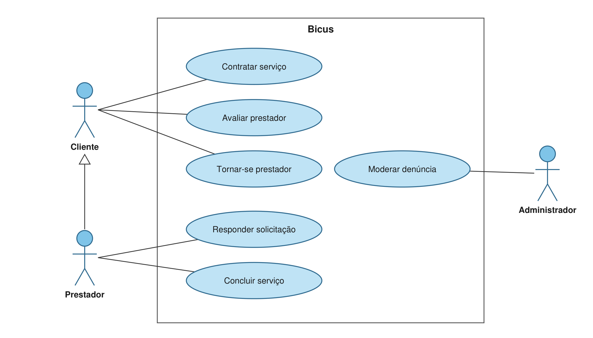
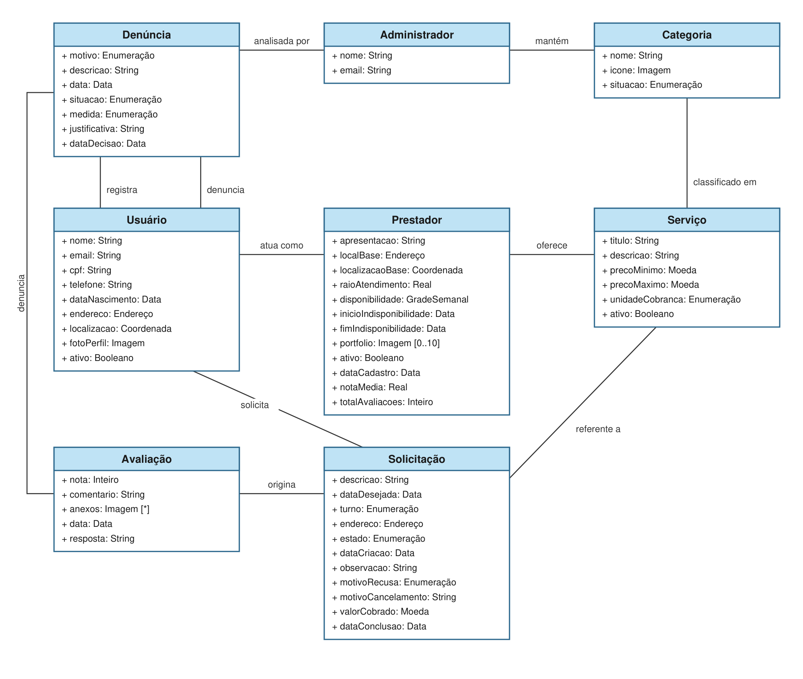

# Organização dos requisitos

## Casos de Uso

| Nome | Atores | Descrição | Referências cruzadas |
|---|---|---|---|
| Contratar serviço | Cliente | O cliente escolhe uma categoria e o raio de busca. O sistema obtém a localização do cliente e exibe os prestadores próximos, ordenados por proximidade e nota. O cliente compara as opções, acessa o perfil de um prestador e envia a ele uma solicitação de serviço. | F7, F8, F9, F10, F11 |
| Responder solicitação | Prestador | O prestador analisa uma solicitação recebida e a aceita ou a recusa, informando o motivo. Com o aceite, os contatos das duas partes são liberados. | F12, F17 |
| Concluir serviço | Prestador | Após realizar o serviço, o prestador localiza a solicitação no histórico e registra a conclusão ou registra o cancelamento, com o motivo. O cliente é notificado para confirmar. | F13, F17 |
| Avaliar prestador | Cliente | O cliente confirma a conclusão do serviço e avalia o prestador com nota e comentário. O sistema recalcula a reputação do prestador, que passa a influenciar a ordem das buscas. | F13, F14, F15 |
| Tornar-se prestador | Cliente | O usuário ativa seu perfil de prestador: escreve a apresentação, confirma o local de atendimento, cadastra os serviços oferecidos e define a disponibilidade. Ao final, passa a aparecer nas buscas. | F4, F5, F6, F7 |
| Moderar denúncia | Administrador | O administrador analisa uma denúncia pendente, examina o conteúdo denunciado e decide arquivá-la ou aplicar uma medida. O sistema aplica os efeitos e notifica os envolvidos. | F18, F19, F15 |

## Diagrama de Casos de Uso

*Prestador é uma especialização de Cliente (um prestador também pode contratar serviços).*

## Modelo Conceitual Preliminar

*Sem métodos, sem multiplicidades e sem direção nas associações, como pede o modelo preliminar da Concepção.*

## Conceitos

| Conceito | C | R | U | D | Observações | Referências cruzadas |
|---|:-:|:-:|:-:|:-:|---|---|
| Usuário | X | X | X | X | Qualquer pessoa maior de 18 anos pode se cadastrar. A exclusão anonimiza os dados pessoais e só é possível sem solicitações em andamento. | F1, F2, F3 |
| Prestador |  | X | X | X | Como a criação do perfil de prestador é um processo iterativo, não trivial (apresentação, serviços e disponibilidade), está descrita no caso de uso “Tornar-se prestador”. A exclusão corresponde à desativação do perfil, só permitida sem solicitações em andamento. | F4, F6, F10 |
| Serviço | X | X | X | X | Só é possível excluir um serviço sem solicitações em andamento. | F5 |
| Categoria | X | X | X | X | Mantida apenas pelo administrador. Só é possível excluir uma categoria sem serviços associados; caso contrário, ela é desativada. | F5, F20 |
| Solicitação |  | X | X |  | Criada apenas pelo caso de uso “Contratar serviço” e alterada (mudança de estado) pelos casos de uso “Responder solicitação”, “Concluir serviço” e “Avaliar prestador”, pelo cancelamento do cliente, pela expiração automática e pela suspensão do prestador. Não é excluída: cancelamentos permanecem no histórico. | F11, F12, F13, F17, F19 |
| Avaliação |  | X | X | X | Criada apenas pelo caso de uso “Avaliar prestador”. Pode ser editada pelo cliente e receber resposta do prestador. É excluída somente por decisão de moderação. | F14, F15, F16, F19 |
| Denúncia | X | X | X |  | Qualquer usuário pode registrar. A decisão é registrada no caso de uso “Moderar denúncia”. Não é excluída, para manter o registro das decisões. | F18, F19 |
| Administrador | X | X | X | X | Contas de administrador são criadas apenas por outro administrador; não há cadastro público. O primeiro administrador é criado na implantação do sistema. | F19, F20 |

## Consultas

| Nome | Referências cruzadas |
|---|---|
| Prestadores mais bem avaliados por categoria e cidade | F1, F5, F8, F14, F15 |
| Categorias mais solicitadas por período | F11, F20 |
| Serviços concluídos por prestador por mês (quantidade e nota média) | F13, F14, F17 |
| Taxa de aceitação e de cancelamento de solicitações por prestador | F11, F12, F13 |
| Novos prestadores cadastrados por categoria e período | F4, F5 |
| Denúncias por motivo e situação em um período | F18, F19 |

---

## Apoio à revisão — matriz de rastreabilidade

Verificação do alerta da aula: todo requisito funcional precisa estar em pelo menos um caso de uso, conceito (CRUD) ou consulta. *(Esta matriz não faz parte do formato do exemplo; é só para conferência.)*

Casos de uso: **UC1** = Contratar serviço; **UC2** = Responder solicitação; **UC3** = Concluir serviço; **UC4** = Avaliar prestador; **UC5** = Tornar-se prestador; **UC6** = Moderar denúncia

| RF | UC1 | UC2 | UC3 | UC4 | UC5 | UC6 | Conceitos | Consultas |
|---|:-:|:-:|:-:|:-:|:-:|:-:|:-:|:-:|
| F1 Cadastrar usuário |  |  |  |  |  |  | X | X |
| F2 Login |  |  |  |  |  |  | X |  |
| F3 Editar dados da conta de usuário |  |  |  |  |  |  | X |  |
| F4 Cadastrar perfil de prestador |  |  |  |  | X |  | X | X |
| F5 Gerenciar serviços oferecidos |  |  |  |  | X |  | X | X |
| F6 Definir disponibilidade |  |  |  |  | X |  | X |  |
| F7 Obter localização geográfica | X |  |  |  | X |  |  |  |
| F8 Buscar prestadores por categoria | X |  |  |  |  |  |  | X |
| F9 Calcular pontuação de recomendação | X |  |  |  |  |  |  |  |
| F10 Visualizar perfil do prestador | X |  |  |  |  |  | X |  |
| F11 Solicitar serviço | X |  |  |  |  |  | X | X |
| F12 Responder solicitação |  | X |  |  |  |  | X | X |
| F13 Concluir serviço |  |  | X | X |  |  | X | X |
| F14 Avaliar prestador |  |  |  | X |  |  | X | X |
| F15 Atualizar reputação do prestador |  |  |  | X |  | X | X | X |
| F16 Responder avaliação |  |  |  |  |  |  | X |  |
| F17 Consultar histórico de solicitações |  | X | X |  |  |  | X | X |
| F18 Denunciar conteúdo |  |  |  |  |  | X | X | X |
| F19 Moderar denúncias |  |  |  |  |  | X | X | X |
| F20 Gerenciar categorias de serviço |  |  |  |  |  |  | X | X |
